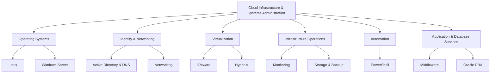

# Infrastructure Learning Domains

This diagram provides a conceptual overview of the technical domains covered in the Cloud Infrastructure & Systems Administration portfolio. It illustrates how the learning areas relate to infrastructure administration and operations.

## How to Use This Diagram

Use this overview to navigate the repository by technical domain. Each domain contains its own README and associated lab material.

**Note:** This is a conceptual learning map, not a production architecture diagram. It does not represent a deployed or integrated infrastructure environment.
